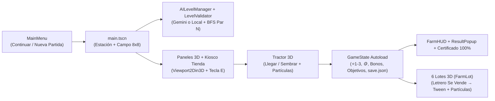

# Gamificación "Granja Tycoon" Implementation Plan

> **For agentic workers:** REQUIRED SUB-SKILL: Use superpowers:subagent-driven-development (recommended) or superpowers:executing-plans to implement this plan task-by-task. Steps use checkbox (`- [ ]`) syntax for tracking.

**Goal:** Transformar el modo escritorio de CodeXperience (`main.tscn`) en un juego educativo de progresión "Granja Tycoon" con evaluación local de 3 estrellas, economía de monedas, desbloqueo de bloques y 6 edificios 3D con bonos pasivos, misiones de Llegar y Sembrar validadas por BFS (con generador local de respaldo), kiosco físico de tienda 3D, objetivos guiados, guardado persistente y alto pulido visual ("game feel").

**Architecture:** Un autoload `GameState` gestiona el progreso, monedas, desbloqueos, objetivos y persistencia atómica en `user://save.json`, apoyado en un catálogo estático `Economy` (`scripts/game/economy.gd`) y un validador/generador `LevelValidator` (`scripts/game/level_validator.gd`) que ejecuta BFS sobre el estado `(celda, dirección)` del tractor. La escena `main.tscn` integra los paneles 3D existentes con un nuevo Kiosco de Tienda (`Viewport2Din3D`), 6 lotes de edificios 3D (`FarmLot`) con letreros "Se vende" y animaciones de construcción (`Tween` + `CPUParticles3D`), y un `FarmHUD` (`CanvasLayer`) con popups animados de 3 estrellas y certificado del 100 %.

**Tech Stack:** Godot 4.7.2 (GDScript 2.0 estático, `GridMap`, `Viewport2Din3D`, `Tween`, `CPUParticles3D`, `StationTheme`, tests headless con `godot --headless --script`).

**Spec:** [2026-11-20-gamificacion-tycoon.md](file:///c:/Users/Steven/Desktop/Projects/CodeXperience/docs/superpowers/specs/2026-11-20-gamificacion-tycoon.md)

---

## Global Constraints

- **Alcance exclusivo escritorio:** Solo se modifica el flujo de `main.tscn` y `main_menu.tscn`; `mainXR.tscn` permanece intacto.
- **Límites reales del GridMap `Casillas`:** Las 64 celdas válidas pintadas en `Casillas` (`main.tscn`) con el tile base `308` (`campfire_bricks3`) van de **`X: -1 a 6`** y **`Z: 11 a 18`** (`Y = 0`), mientras que el tractor inicia en `(-1, 0, 19)` mirando al Norte (`-Z`). Tanto `tractor.gd` como `ai_level_manager.gd` y `level_validator.gd` deben usar `GRID_MIN_X = -1, GRID_MAX_X = 6, GRID_MIN_Z = 11, GRID_MAX_Z = 18` y restaurar siempre el tile base `308` al limpiar celdas (nunca `INVALID_CELL_ITEM`, que deja huecos intransitables).
- **Tabla de Economía Exacta (`Economy`):**
  - Bloques: `interactuar` = 30 🪙, `for_loop` = 50 🪙, `variables` = 80 🪙, `while_loop` = 100 🪙, `if_else` = 120 🪙 (Total bloques = 380 🪙; `avanzar`, `girar_derecha`, `girar_izquierda` desbloqueados desde el inicio).
  - Edificios: `fences` (Cercas) = 40 🪙, `well` (Pozo) = 60 🪙, `chicken_coop` (Gallinero) = 90 🪙, `silo` (Silo) = 120 🪙, `windmill` (Molino) = 150 🪙, `barn` (Granero) = 250 🪙 (Total edificios = 710 🪙).
  - Pista: `HINT_COST = 5` 🪙 (1 gratis por nivel si `well` está comprado).
- **Fórmula de Estrellas y Monedas:**
  - ⭐1: completar misión (`reach`: terminar en `target`; `plant`: sembrar todas las `plant_cells` con `interactuar()` y terminar en `target`).
  - ⭐2: total de bloques ejecutables (`count_code_blocks(code_text)`) $\le$ `par_blocks`.
  - ⭐3: completado en el primer intento del nivel (`attempts == 1`) y sin haber usado pista (`not hint_used`).
  - Monedas del nivel: `base = 10 * stars` + bono Gallinero (`+1 * stars` si `chicken_coop`) $\rightarrow$ multiplicador Silo (`+10 %` si `silo`) + multiplicador Molino (`+50 %` si `windmill` y `mission == "plant"`), redondeado al entero superior (`ceili`).
- **Meta Final:** `"Granja restaurada" = 100 %` al adquirir los 5 paquetes de bloques comprables + 6 edificios (11 mejoras totales). Muestra el popup de Certificado/Créditos y habilita el Modo Libre.

## Review Focus

1. **Restauración del tile base `308` en `Casillas`:** Al limpiar un nivel o reiniciar el tractor tras un intento fallido en misión `"plant"`, las celdas de meta, obstáculos y siembra deben volver al tile base `308` (o al marcador de `plant_cells` si se reinicia el mismo nivel), nunca a `INVALID_CELL_ITEM`. Cubierto en Task 4.
2. **Reinicio de celdas sembradas entre intentos del mismo nivel:** Si el jugador siembra 1 de 2 casillas y luego choca o no llega a la meta, `tractor.reset_state()` y `ai_manager.reset_level_tiles()` deben vaciar `tractor.planted_cells` y repintar las `plant_cells` pendientes. Cubierto en Task 4.
3. **Conteo de bloques con bucles/condicionales anidados:** `LevelValidator.count_code_blocks(code_text)` debe contar líneas ejecutables reales ignorando líneas vacías, comentarios (`#`) y `pass`, de modo que `for i in range(4):\n\tavanzar()` cuente como `2` bloques y premie usar bucles frente a `4` `avanzar()`. Cubierto en Task 3.
4. **Conversión `float` → `int` al cargar JSON en Godot:** `JSON.parse_string()` convierte todos los números a `float`; `GameState.load_game()` debe convertir `version`, `coins`, `current_objective_index`, `levels_completed` y `total_stars` con `int()` y validar claves faltantes. Cubierto en Task 2.
5. **Pista gratis del Pozo una sola vez por nivel:** Si el jugador posee `well`, la primera pista del nivel cuesta `0 🪙` (pero igual marca `hint_used = true` e inhabilita ⭐3); si vuelve a pulsar Pista en el mismo nivel, no debe cobrar de nuevo ni fallar, sino re-mostrar la pista actual. Cubierto en Task 2 y Task 5.

---

## Arquitectura y Flujo Visual



## Mapa de Archivos

| Archivo | Acción | Responsabilidad |
|---|---|---|
| `scripts/game/economy.gd` | Crear | Catálogo estático de bloques, edificios, precios, bonos y los 12 Objetivos del Granjero. |
| `scripts/game/game_state.gd` | Crear | Autoload `GameState`: estado de partida, cálculo de estrellas/monedas/bonos, compra, pistas, objetivos y guardado atómico `user://save.json`. |
| `scripts/game/level_validator.gd` | Crear | BFS sobre `(Vector3i, dir_index)` con subconjunto de `plant_cells`, cálculo de `par_blocks`, conteo de bloques y generador local de niveles. |
| `tests/test_runner.gd` | Crear | Runner headless (`extends SceneTree`) para ejecutar tests unitarios de `Economy`, `GameState` y `LevelValidator` desde CLI. |
| `scenes/world/farm_lot.gd` | Crear | Controlador de lote 3D: alterna entre letrero `"SE VENDE"` flotante y edificio 3D con tween `TRANS_BACK`, partículas y animación pasiva (aspas del molino). |
| `scenes/ui/panel_shop/panel_shop.gd` | Crear | UI 2D del Kiosco de Tienda con `StationTheme`: tarjetas de bloques y edificios, precios, bonos, barra de restauración y feedback de compra. |
| `scenes/ui/panel_shop/panel_shop.tscn` | Crear | Escena raíz `Control` para el `Viewport2Din3D` del Kiosco de Tienda. |
| `scenes/ui/hud/farm_hud.gd` | Crear | HUD `CanvasLayer` con contador animado de 🪙, barra de "Granja restaurada", tarjeta de Objetivo del Granjero, banner de misión y toast de objetivo cumplido. |
| `scenes/ui/hud/level_result_popup.gd` | Crear | Popup modal al completar nivel: animación secuencial de 3 estrellas, desglose de monedas + bonos y botón Siguiente Nivel. |
| `scenes/ui/hud/victory_certificate_popup.gd` | Crear | Popup de Certificado/Créditos al llegar al 100 % de Granja Restaurada con transición a Modo Libre. |
| `scenes/main/ai_level_manager.gd` | Modificar | Ampliar esquema JSON (`mission`, `plant_cells`, `par_blocks`, `hint`), inyectar bloques desbloqueados en el prompt, validar con `LevelValidator`, usar fallback local y pintar marcadores 3D en el campo. |
| `scenes/tractor/tractor.gd` | Modificar | Ajustar `GRID_MIN_X = -1`, registrar `planted_cells` en `interactuar()`, añadir partículas al sembrar/chocar y sacudida visual en colisión. |
| `scenes/ui/panel_actions/panel_actions.gd` | Modificar | Bloquear/desbloquear botones según `GameState.is_block_unlocked()`, mostrando `🔒 Nombre (X 🪙)` y actualizándose por señal. |
| `scenes/ui/panel_variables/panel_variables.gd` | Modificar | Mostrar tarjeta de bloqueo `🔒 Taller de Variables (80 🪙)` cuando `"variables"` no esté desbloqueado. |
| `scenes/ui/panel_code/panel_code.tscn` y `.gd` | Modificar | Añadir botón `💡 Pista` en la barra de herramientas y banner de pista activa. |
| `scenes/ui/main_menu/main_menu.tscn` y `.gd` | Modificar | Botones `▶ Continuar partida` (con resumen de progreso) y `🌱 Nueva partida`, más subtítulo renovado. |
| `scenes/main/main.tscn` y `main.gd` | Modificar | Conectar `GameState`, `FarmHUD`, `panel_shop` (Kiosco 3D junto al palco), nodo `FarmLots` con los 6 edificios 3D, evaluación de misiones `reach`/`plant` y conteo de intentos/pistas. |
| `project.godot` | Modificar | Registrar autoload `GameState="*res://scripts/game/game_state.gd"`. |

---

### Task 1: Catálogo de Economía, Objetivos y Runner de Tests Headless

**Files:**
- Create: `scripts/game/economy.gd`
- Create: `tests/test_runner.gd`

**Interfaces:**
- Produces:
  - `class_name Economy`
  - `const INITIAL_UNLOCKED_BLOCKS: Array[String] = ["avanzar", "girar_derecha", "girar_izquierda"]`
  - `const BLOCK_PRICES: Dictionary` (`"interactuar": 30`, `"for_loop": 50`, `"variables": 80`, `"while_loop": 100`, `"if_else": 120`)
  - `const BLOCK_INFO: Dictionary` (id → `{ "name": String, "price": int, "desc": String, "icon": String }`)
  - `const BUILDING_PRICES: Dictionary` (`"fences": 40`, `"well": 60`, `"chicken_coop": 90`, `"silo": 120`, `"windmill": 150`, `"barn": 250`)
  - `const BUILDING_INFO: Dictionary` (id → `{ "name": String, "price": int, "bonus": String, "scene_path": String, "icon": String }`)
  - `const HINT_COST: int = 5`
  - `const OBJECTIVES: Array[Dictionary]` (12 objetivos lineales con `id`, `title`, `desc`, `reward`, `type`, `target`)
  - `static func get_total_upgrade_count() -> int` (devuelve `11`: 5 bloques comprables + 6 edificios)

- [ ] **Step 1: Write the failing test in `tests/test_runner.gd`**

```gdscript
extends SceneTree

var passed := 0
var failed := 0

func _initialize() -> void:
	test_economy_catalog()
	print("Results: %d passed, %d failed" % [passed, failed])
	quit(1 if failed > 0 else 0)

func assert_eq(actual: Variant, expected: Variant, label: String) -> void:
	if actual == expected:
		passed += 1
	else:
		failed += 1
		push_error("FAIL %s: expected %s, got %s" % [label, expected, actual])

func test_economy_catalog() -> void:
	assert_eq(Economy.BLOCK_PRICES["interactuar"], 30, "price_interactuar")
	assert_eq(Economy.BLOCK_PRICES["for_loop"], 50, "price_for_loop")
	assert_eq(Economy.BLOCK_PRICES["variables"], 80, "price_variables")
	assert_eq(Economy.BLOCK_PRICES["while_loop"], 100, "price_while_loop")
	assert_eq(Economy.BLOCK_PRICES["if_else"], 120, "price_if_else")
	assert_eq(Economy.BUILDING_PRICES["fences"], 40, "price_fences")
	assert_eq(Economy.BUILDING_PRICES["well"], 60, "price_well")
	assert_eq(Economy.BUILDING_PRICES["chicken_coop"], 90, "price_chicken_coop")
	assert_eq(Economy.BUILDING_PRICES["silo"], 120, "price_silo")
	assert_eq(Economy.BUILDING_PRICES["windmill"], 150, "price_windmill")
	assert_eq(Economy.BUILDING_PRICES["barn"], 250, "price_barn")
	assert_eq(Economy.HINT_COST, 5, "hint_cost")
	assert_eq(Economy.get_total_upgrade_count(), 11, "total_upgrades_11")
	assert_eq(Economy.OBJECTIVES.size(), 12, "objectives_count_12")
```

- [ ] **Step 2: Run headless test to verify it fails**

Run: `godot --headless --path . --script res://tests/test_runner.gd`
Expected: FAIL (`Identifier "Economy" not declared in the current scope`)

- [ ] **Step 3: Implement `Economy` in `scripts/game/economy.gd`**

Definir `class_name Economy extends RefCounted` con las constantes de precios exactas de la especificación, metadatos visuales (`BLOCK_INFO`, `BUILDING_INFO` apuntando a `res://assets/scenes/farm_assets/structures/Bld_*.tscn`) y los 12 objetivos lineales en `OBJECTIVES`:
1. `first_level` ("Primeros surcos", completar 1 nivel, +15 🪙)
2. `save_30_coins` ("Ahorro inicial", alcanzar 30 🪙, +15 🪙)
3. `buy_interactuar` ("Manos a la tierra", comprar bloque `interactuar`, +20 🪙)
4. `first_plant` ("Primera cosecha", completar 1 misión `"plant"`, +25 🪙)
5. `buy_fences` ("Terreno cercado", construir `fences`, +20 🪙)
6. `buy_for_loop` ("Automatización", comprar bloque `for_loop`, +25 🪙)
7. `buy_well` ("Agua fresca", construir `well`, +25 🪙)
8. `three_stars` ("Código eficiente", lograr 3 estrellas en un nivel, +30 🪙)
9. `buy_chicken_coop` ("Granja avícola", construir `chicken_coop`, +30 🪙)
10. `buy_vars_and_while` ("Lógica avanzada", comprar `variables` y `while_loop`, +40 🪙)
11. `buy_silo_and_windmill` ("Cosecha mayor", construir `silo` y `windmill`, +40 🪙)
12. `restore_100` ("Maestro Granjero", comprar `if_else` y construir `barn` para el 100 %, +50 🪙)

- [ ] **Step 4: Import and run test to verify it passes**

Run: `godot --headless --path . --import; godot --headless --path . --script res://tests/test_runner.gd`
Expected: `Results: 14 passed, 0 failed` (exit code 0)

---

### Task 2: Autoload `GameState` (Estrellas, Bonos, Tienda, Pistas, Objetivos y Guardado Atómico)

**Files:**
- Create: `scripts/game/game_state.gd`
- Modify: `project.godot:18-24`
- Test: `tests/test_runner.gd`

**Interfaces:**
- Consumes: `Economy`
- Produces (en autoload `GameState`):
  - Signals:
    - `coins_changed(new_coins: int, delta: int)`
    - `blocks_updated()`
    - `building_purchased(building_id: String)`
    - `restoration_changed(percent: int)`
    - `objective_updated(objective: Dictionary)`
    - `objective_completed(objective: Dictionary)`
    - `victory_100_reached()`
  - Properties:
    - `save_path: String = "user://save.json"` (configurable en tests a `user://test_save.json`)
    - `coins: int = 0`
    - `unlocked_blocks: Array[String]`
    - `purchased_buildings: Array[String]`
    - `current_objective_index: int = 0`
    - `levels_completed: int = 0`
    - `plant_levels_completed: int = 0`
    - `total_stars: int = 0`
    - `max_stars_in_single_level: int = 0`
    - `free_play_unlocked: bool = false`
    - `free_hint_used_this_level: bool = false`
  - Methods:
    - `reset_new_game(persist: bool = true) -> void`
    - `has_save_file() -> bool`
    - `save_game() -> Error`
    - `load_game() -> bool`
    - `is_block_unlocked(block_key: String) -> bool` (mapea `"if_block"` y `"else_block"` a `"if_else"`, `"var_decl"`/`"var_ref"`/`"var_inc"` a `"variables"`)
    - `is_building_purchased(building_id: String) -> bool`
    - `buy_block(block_id: String) -> bool`
    - `buy_building(building_id: String) -> bool`
    - `get_restoration_percent() -> int`
    - `on_level_started() -> void` (reinicia `free_hint_used_this_level = false`)
    - `get_hint_cost() -> int` (`0` si tiene `"well"` y `not free_hint_used_this_level`, si no `Economy.HINT_COST`)
    - `try_purchase_hint() -> Dictionary` (`{ "ok": bool, "cost": int, "reason": String }`)
    - `calculate_stars(completed: bool, blocks_used: int, par_blocks: int, attempts: int, hint_used: bool) -> int`
    - `award_level(mission: String, blocks_used: int, par_blocks: int, attempts: int, hint_used: bool) -> Dictionary` (devuelve `{ "stars": int, "base_coins": int, "coop_bonus": int, "silo_bonus": int, "windmill_bonus": int, "objective_bonus": int, "total_coins_earned": int, "completed_objectives": Array }`)
    - `get_current_objective() -> Dictionary`

- [ ] **Step 1: Add failing tests for `GameState` in `tests/test_runner.gd`**

```gdscript
func test_game_state_progression_and_save() -> void:
	var gs := preload("res://scripts/game/game_state.gd").new()
	gs.save_path = "user://test_save_runner.json"
	gs.reset_new_game(false)

	# 1. Cálculo de estrellas
	assert_eq(gs.calculate_stars(true, 4, 4, 1, false), 3, "stars_3_perfect")
	assert_eq(gs.calculate_stars(true, 4, 4, 2, false), 2, "stars_2_second_attempt")
	assert_eq(gs.calculate_stars(true, 4, 4, 1, true), 2, "stars_2_used_hint")
	assert_eq(gs.calculate_stars(true, 6, 4, 1, false), 1, "stars_1_over_par")

	# 2. Recompensa nivel 1 + Objetivo 1 ("first_level" +15) + Objetivo 2 ("save_30_coins" +15)
	var res1: Dictionary = gs.award_level("reach", 3, 4, 1, false)
	assert_eq(res1["stars"], 3, "award_stars_3")
	assert_eq(res1["base_coins"], 30, "award_base_30")
	assert_eq(gs.coins, 60, "coins_after_lvl1_and_2_objectives")

	# 3. Compra de bloque e inmueble + bonos (Gallinero, Silo, Molino, Pozo)
	assert_eq(gs.buy_block("interactuar"), true, "buy_interactuar_ok")
	gs.coins = 500
	assert_eq(gs.buy_building("well"), true, "buy_well_ok")
	assert_eq(gs.buy_building("chicken_coop"), true, "buy_coop_ok")
	assert_eq(gs.buy_building("silo"), true, "buy_silo_ok")
	assert_eq(gs.buy_building("windmill"), true, "buy_windmill_ok")

	# Pista gratis del Pozo: 1ra gratis, 2da cuesta 5
	gs.on_level_started()
	assert_eq(gs.get_hint_cost(), 0, "well_first_hint_free")
	var h1: Dictionary = gs.try_purchase_hint()
	assert_eq(h1["ok"], true, "well_hint_1_ok")
	assert_eq( h1["cost"], 0, "well_hint_1_cost_0")
	assert_eq(gs.get_hint_cost(), 5, "well_second_hint_costs_5")

	# Bonos combinados en misión "plant" con 3 estrellas:
	# base = 30, gallinero = +3 (subtotal 33), silo +10% (+3.3), molino +50% (+16.5) -> total 53
	var res_plant: Dictionary = gs.award_level("plant", 4, 4, 1, false)
	assert_eq(res_plant["base_coins"], 30, "plant_base_30")
	assert_eq(res_plant["coop_bonus"], 3, "plant_coop_3")
	assert_eq(res_plant["silo_bonus"] + res_plant["windmill_bonus"], 20, "plant_pct_bonuses_20")

	# 4. Guardado y carga atómica (JSON float->int safety)
	assert_eq(gs.save_game(), OK, "save_game_ok")
	var gs2 := preload("res://scripts/game/game_state.gd").new()
	gs2.save_path = "user://test_save_runner.json"
	assert_eq(gs2.load_game(), true, "load_game_ok")
	assert_eq(gs2.coins, gs.coins, "loaded_coins_match")
	assert_eq(gs2.is_block_unlocked("interactuar"), true, "loaded_block_unlocked")
	assert_eq(gs2.is_building_purchased("windmill"), true, "loaded_building_purchased")
```

- [ ] **Step 2: Run test to verify it fails**

Run: `godot --headless --path . --script res://tests/test_runner.gd`
Expected: FAIL (`Unable to load script "res://scripts/game/game_state.gd"`)

- [ ] **Step 3: Implement `scripts/game/game_state.gd` and register autoload in `project.godot`**

Implementar `scripts/game/game_state.gd` con escritura atómica (`save_path + ".tmp"` $\rightarrow$ backup `.bak` $\rightarrow$ `DirAccess.rename_absolute`), conversión explícita `int(...)` al deserializar JSON, evaluación encadenada de objetivos en `_check_objectives()` (un mismo nivel puede completar el objetivo actual y desbloquear el siguiente si ya cumple la condición, p. ej. llegar a 30 🪙 en el primer nivel), y registrar `GameState="*res://scripts/game/game_state.gd"` en `[autoload]` de `project.godot`.

- [ ] **Step 4: Run test to verify it passes**

Run: `godot --headless --path . --import; godot --headless --path . --script res://tests/test_runner.gd`
Expected: PASS (`0 failed`)

---

### Task 3: Validador BFS, Cálculo de Par (`N`) y Generador Local de Niveles

**Files:**
- Create: `scripts/game/level_validator.gd`
- Test: `tests/test_runner.gd`

**Interfaces:**
- Consumes: `Economy`
- Produces (`class_name LevelValidator extends RefCounted`):
  - `const MIN_X := -1`, `const MAX_X := 6`, `const MIN_Z := 11`, `const MAX_Z := 18`
  - `static func is_in_bounds(cell: Vector3i) -> bool`
  - `static func count_code_blocks(code_text: String) -> int` (cuenta líneas ejecutables no vacías, excluyendo `#` y `pass`)
  - `static func validate_and_score_level(start_pos: Vector3i, start_dir: int, target_pos: Vector3i, obstacles: Array[Vector3i], plant_cells: Array[Vector3i], unlocked_blocks: Array[String]) -> Dictionary`
    - Devuelve `{ "solvable": bool, "min_actions": int, "par_blocks": int, "optimal_actions": Array[String] }`.
  - `static func sanitize_or_fallback(raw_data: Dictionary, start_pos: Vector3i, start_dir: int, unlocked_blocks: Array[String], level_index: int) -> Dictionary`
    - Valida el JSON recibido de Gemini (o vacío); si es inválido, usa misión `"plant"` sin tener `"interactuar"`, coloca coordenadas fuera de `X: -1..6, Z: 11..18`, o el BFS da `solvable == false`, genera automáticamente un nivel local válido con `generate_fallback_level(...)`.
  - `static func generate_fallback_level(start_pos: Vector3i, start_dir: int, unlocked_blocks: Array[String], level_index: int) -> Dictionary`
    - Devuelve `{ "mission": "reach" | "plant", "target": {"x": int, "z": int}, "obstacles": Array, "plant_cells": Array, "par_blocks": int, "hint": String, "message": String }` 100 % validado por BFS.

- [ ] **Step 1: Add failing tests for `LevelValidator` in `tests/test_runner.gd`**

```gdscript
func test_level_validator_bfs_and_fallback() -> void:
	var start := Vector3i(-1, 0, 19)
	var dir_north := 0 # Vector3i(0, 0, -1)

	# 1. Línea recta 3 pasos al norte: (-1,0,19) -> (-1,0,16)
	var r1: Dictionary = LevelValidator.validate_and_score_level(
		start, dir_north, Vector3i(-1, 0, 16), [], [], ["avanzar", "girar_derecha", "girar_izquierda"]
	)
	assert_eq(r1["solvable"], true, "bfs_straight_solvable")
	assert_eq(r1["min_actions"], 3, "bfs_straight_3_actions")
	assert_eq(r1["par_blocks"], 3, "bfs_straight_par_3_no_loops")

	# 2. Línea recta 5 pasos con for_loop desbloqueado: par_blocks comprime recta a 2 bloques
	var r_loop: Dictionary = LevelValidator.validate_and_score_level(
		start, dir_north, Vector3i(-1, 0, 14), [], [], ["avanzar", "girar_derecha", "girar_izquierda", "for_loop"]
	)
	assert_eq(r_loop["solvable"], true, "bfs_loop_solvable")
	assert_eq(r_loop["par_blocks"], 2, "bfs_loop_par_compressed_to_2")

	# 3. Meta rodeada de obstáculos -> irresoluble
	var blocked_obs: Array[Vector3i] = [
		Vector3i(2, 0, 14), Vector3i(2, 0, 16), Vector3i(1, 0, 15), Vector3i(3, 0, 15)
	]
	var r_blocked: Dictionary = LevelValidator.validate_and_score_level(
		start, dir_north, Vector3i(2, 0, 15), blocked_obs, [], ["avanzar", "girar_derecha", "girar_izquierda"]
	)
	assert_eq(r_blocked["solvable"], false, "bfs_surrounded_unsolvable")

	# 4. Conteo de bloques de código
	var sample_code := "for i in range(4):\n\tavanzar()\n\t# comentario\ngirar_derecha()\navanzar()"
	assert_eq(LevelValidator.count_code_blocks(sample_code), 4, "count_code_blocks_4")

	# 5. Generador local de respaldo (con y sin interactuar)
	for idx in range(1, 8):
		var blocks: Array[String] = ["avanzar", "girar_derecha", "girar_izquierda"]
		if idx >= 3:
			blocks.append("interactuar")
		if idx >= 5:
			blocks.append("for_loop")
		var lvl: Dictionary = LevelValidator.generate_fallback_level(start, dir_north, blocks, idx)
		assert_eq(lvl.has("hint") and not str(lvl["hint"]).is_empty(), true, "fallback_has_hint_" + str(idx))
		assert_eq(int(lvl["par_blocks"]) >= 1, true, "fallback_has_par_" + str(idx))
```

- [ ] **Step 2: Run test to verify it fails**

Run: `godot --headless --path . --script res://tests/test_runner.gd`
Expected: FAIL (`Identifier "LevelValidator" not declared in the current scope`)

- [ ] **Step 3: Implement `scripts/game/level_validator.gd`**

Implementar el BFS sobre estados `(pos: Vector3i, dir: int, planted_mask: int)`:
- Transiciones de costo 1:
  - `avanzar()`: si `next_pos = pos + DIRECTIONS[dir]` está en `X: -1..6, Z: 11..18` y no está en `obstacles`.
  - `girar_derecha()`: `dir = (dir + 1) % 4`.
  - `girar_izquierda()`: `dir = (dir + 3) % 4`.
  - `interactuar()`: si `pos` es la `i`-ésima celda de `plant_cells` y el bit `i` en `planted_mask` es `0`, activa el bit `i` (`planted_mask | (1 << i)`).
- Condición de parada: `pos == target_pos` y `planted_mask == (1 << plant_cells.size()) - 1`.
- Cálculo de `par_blocks`: a partir de `optimal_actions`, si `"for_loop"` o `"while_loop"` está en `unlocked_blocks`, toda racha de $k \ge 3$ acciones idénticas consecutivas (`"avanzar"`) o pares repetidos `["avanzar", "interactuar"]` suma `2` (o `3`) bloques en vez de $k$.

- [ ] **Step 4: Run test to verify it passes**

Run: `godot --headless --path . --import; godot --headless --path . --script res://tests/test_runner.gd`
Expected: PASS (`0 failed`)

---

### Task 4: `AILevelManager` y `Tractor` — Misiones Sembrar, Pistas, Límites y Efectos Visuales 3D

**Files:**
- Modify: `scenes/tractor/tractor.gd`
- Modify: `scenes/main/ai_level_manager.gd`
- Test: `tests/test_runner.gd`

**Interfaces:**
- Consumes: `LevelValidator`, `GameState`
- Produces:
  - En `tractor.gd`:
    - `const GRID_MIN_X: int = -1`, `GRID_MAX_X: int = 6`, `GRID_MIN_Z: int = 11`, `GRID_MAX_Z: int = 18`
    - `var planted_cells: Array[Vector3i] = []`
    - `signal cell_planted(grid_pos: Vector3i)`
    - `func has_planted_all(required_cells: Array[Vector3i]) -> bool`
    - Efectos visuales 3D en `tractor.gd`: partículas `CPUParticles3D` de tierra/hojas doradas al ejecutar `interactuar()`, partículas + flash rojo y micro-sacudida al chocar en `avanzar()`.
  - En `ai_level_manager.gd`:
    - `signal level_configured(level_data: Dictionary)`
    - `var base_tile_id: int = 308`
    - `var plant_marker_item_id: int = 234` (`crops_dirtSingle3`)
    - `var current_mission: String = "reach"`
    - `var current_plant_cells: Array[Vector3i] = []`
    - `var current_par_blocks: int = 1`
    - `var current_hint: String = ""`
    - `func request_next_level(tractor_pos: Vector3i, user_code: String = "") -> void` (si `api_key.is_empty()` o falla HTTP/JSON, invoca `LevelValidator.generate_fallback_level` sin bloquear al jugador; si usa Gemini, pide el JSON extendido con `mission`, `target`, `obstacles`, `plant_cells`, `par_blocks`, `hint`, `message` filtrando por `GameState.unlocked_blocks`, y pasa la respuesta por `LevelValidator.sanitize_or_fallback`).
    - `func reset_level_tiles() -> void` (restaura `current_plant_cells` a `plant_marker_item_id` y `current_target_pos` a `target_item_id` cuando el jugador reintenta el mismo nivel).
    - `func clear_current_level() -> void` (restaura todas las celdas modificadas del grid `X: -1..6, Z: 11..18` a `base_tile_id = 308`, eliminando marcadores 3D flotantes del nivel anterior).
    - Marcadores visuales 3D sobre el campo: anillos/halos luminosos suaves y flotantes (`MeshInstance3D` con `TorusMesh` / `Label3D` `🎯 META` y `🌱 SEMBRAR`) sobre `current_target_pos` y cada `current_plant_cells` para que se distingan perfectamente tanto desde el palco como desde la cámara cenital.

- [ ] **Step 1: Add unit test in `tests/test_runner.gd` for `tractor.has_planted_all` and `ai_level_manager` fallback**

```gdscript
func test_tractor_planting_and_ai_fallback() -> void:
	var tractor_script := preload("res://scenes/tractor/tractor.gd")
	assert_eq(tractor_script.GRID_MIN_X, -1, "tractor_grid_min_x_fixed_to_minus_1")

	var ai := preload("res://scenes/main/ai_level_manager.gd").new()
	ai._apply_level_data(LevelValidator.generate_fallback_level(
		Vector3i(-1, 0, 19), 0, ["avanzar", "girar_derecha", "girar_izquierda", "interactuar"], 3
	))
	assert_eq(ai.current_par_blocks >= 1, true, "ai_par_blocks_set")
	assert_eq(ai.current_hint.is_empty(), false, "ai_hint_set")
```

- [ ] **Step 2: Run test to verify it fails**

Run: `godot --headless --path . --script res://tests/test_runner.gd`
Expected: FAIL (`tractor_grid_min_x_fixed_to_minus_1: expected -1, got -6`)

- [ ] **Step 3: Update `scenes/tractor/tractor.gd` and `scenes/main/ai_level_manager.gd`**

- En `scenes/tractor/tractor.gd`:
  - Cambiar `GRID_MIN_X = -1`.
  - Añadir `var planted_cells: Array[Vector3i] = []` y limpiarlo en `reset_state()`.
  - En `interactuar()`, si `current_grid_pos` no está en `planted_cells`, agregarlo, emitir `cell_planted.emit(current_grid_pos)`, plantar `crops_wheatStageB3` y disparar un burst de `CPUParticles3D` (color verde/dorado) en la posición del tractor.
  - En `avanzar()`, cuando ocurre un crash contra límite u obstáculo, disparar un flash rojizo y sacudida corta de posición antes de detenerse.
- En `scenes/main/ai_level_manager.gd`:
  - Detectar `base_tile_id` (`308`), `plant_marker_item_id` (`crops_dirtSingle3`, `234`), `target_item_id` y `obstacle_item_id`.
  - Si `api_key.is_empty()` o falla la red, generar nivel inmediato con `LevelValidator.generate_fallback_level(...)` y emitir `level_loaded` + `level_configured`.
  - En `clear_current_level()`, restaurar toda celda de `X: -1..6, Z: 11..18` a `base_tile_id` (`308`) y liberar los marcadores 3D flotantes (`🎯` / `🌱`).
  - En `reset_level_tiles()`, repintar las celdas del nivel actual (`base_tile_id`, luego `current_plant_cells` con `plant_marker_item_id`, `current_obstacles` con `obstacle_item_id`, y `current_target_pos` con `target_item_id`) para que los reintentos tras fallar una siembra queden limpios.

- [ ] **Step 4: Run test to verify it passes**

Run: `godot --headless --path . --script res://tests/test_runner.gd`
Expected: PASS (`0 failed`)

---

### Task 5: Bloqueo/Desbloqueo de Bloques en Paneles + Botón de Pista en `PanelCode`

**Files:**
- Modify: `scenes/ui/panel_actions/panel_actions.gd`
- Modify: `scenes/ui/panel_variables/panel_variables.gd`
- Modify: `scenes/ui/panel_code/panel_code.tscn`
- Modify: `scenes/ui/panel_code/panel_code.gd`

**Interfaces:**
- Consumes: `GameState`, `Economy`
- Produces:
  - En `panel_actions.gd`:
    - `func refresh_unlocks() -> void` (conectado a `GameState.blocks_updated`): actualiza el estado `disabled` y el texto de:
      - Botón `Interactuar()` (en paleta principal y en constructor interno): `"✋ Interactuar()"` si desbloqueado, `"🔒 Interactuar() (30 🪙)"` si bloqueado.
      - Botón `Armar Bucle FOR` y spinner: `"Armar Bucle FOR"` vs `"🔒 Bucle FOR (50 🪙)"`.
      - Botón `Armar Bucle WHILE`: `"Armar Bucle WHILE"` vs `"🔒 Bucle WHILE (100 🪙)"`.
      - Botones `Armar IF` y `Bloque ELSE simple`: desbloqueados juntos con `"if_else"` (`"🔒 Condicional IF / ELSE (120 🪙)"`).
  - En `panel_variables.gd`:
    - `func refresh_unlocks() -> void` (conectado a `GameState.blocks_updated`): cuando `"variables"` no está desbloqueado, muestra un banner/overlay destacado `"🔒 Taller de Variables bloqueado — Desbloquéalo en el Kiosco de la Tienda por 80 🪙"` y deshabilita `btn_create` y los spinners.
  - En `panel_code.tscn` y `panel_code.gd`:
    - `signal hint_requested()`
    - Botón `BtnHint` en `Toolbar`: muestra `"💡 Pista (5 🪙)"` o `"💡 Pista (Gratis)"` según `GameState.get_hint_cost()`, y `"💡 Ver Pista"` si ya fue adquirida en el nivel actual.
    - `func mostrar_pista(hint_text: String) -> void` (muestra la pista con formato ámbar destacado en la terminal y un pequeño pulso de escala en el control).
    - `func update_mission_banner(mission_text: String, par_blocks: int) -> void` (actualiza el subtítulo del panel con la meta actual y el Par `N` para ⭐2).

- [ ] **Step 1: Implement lock/unlock states in `panel_actions.gd` and `panel_variables.gd`**

Conectar `_ready()` de ambos paneles a `GameState.blocks_updated.connect(refresh_unlocks)` (usando `get_node_or_null("/root/GameState")` para seguir funcionando si la escena se abre aislada) y llamar a `refresh_unlocks()` al final de `_ready()`.

- [ ] **Step 2: Add `BtnHint` to `panel_code.tscn` and implement hint logic in `panel_code.gd`**

Añadir `BtnHint` (`theme_type_variation = "StationAccent"`) en `MarginContainer/VBoxContainer/Toolbar` de `panel_code.tscn` y conectar su señal `pressed` en `panel_code.gd` a `hint_requested.emit()`.

- [ ] **Step 3: Verify scenes and scripts load cleanly**

Run: `godot --headless --path . --script res://tests/test_runner.gd`
Expected: PASS (`0 failed`, sin errores de parseo en ninguno de los paneles modificados)

---

### Task 6: Kiosco Físico de Tienda 3D (`Viewport2Din3D`) y 6 Lotes de Edificios (`FarmLot`) en `main.tscn`

**Files:**
- Create: `scenes/ui/panel_shop/panel_shop.gd`
- Create: `scenes/ui/panel_shop/panel_shop.tscn`
- Create: `scenes/world/farm_lot.gd`

**Interfaces:**
- Consumes: `GameState`, `Economy`, `StationTheme`
- Produces:
  - `scenes/ui/panel_shop/panel_shop.tscn` + `panel_shop.gd`:
    - Panel 2D (960×540) con `StationTheme` diseñado para renderizarse dentro de un `Viewport2Din3D` en el grupo `"desktop_panels"` (`metadata/display_name = "Tienda de la Granja"`), interactuable con la tecla `E`.
    - Encabezado con saldo `🪙`, barra `ProgressBar` de **"🏡 Granja Restaurada: XX %"** y dos columnas con scroll:
      - Columna izquierda: **🧩 Bloques de Programación** (`interactuar`, `for_loop`, `variables`, `while_loop`, `if_else`).
      - Columna derecha: **🏗️ Edificios de la Granja** (`fences`, `well`, `chicken_coop`, `silo`, `windmill`, `barn`) mostrando su bono pasivo.
    - Al pulsar comprar: llama a `GameState.buy_block(id)` o `GameState.buy_building(id)`, anima la tarjeta con un tween de rebote (`TRANS_BACK`) y actualiza estados.
  - `scenes/world/farm_lot.gd` (`class_name FarmLot extends Node3D`):
    - `@export var building_id: String = ""`
    - `@export var building_scene: PackedScene`
    - `@export var building_scale: Vector3 = Vector3.ONE`
    - En `_ready()`:
      - Instancia un cartel 3D "Se vende" usando `res://assets/scenes/farm_assets/structures/Bld_Farm_Sign_01.tscn` + `Label3D` con borde oscuro, fuente grande y bobbing sinusoidal suave (`"🏷️ SE VENDE\n%s\n%d 🪙\n%s"`).
      - Si `GameState.is_building_purchased(building_id)` ya es `true` al cargar la escena, muestra el edificio inmediatamente sin animación.
      - Se conecta a `GameState.building_purchased`: cuando `id == building_id`, oculta el cartel y ejecuta `play_build_animation()`:
        - Aparece el edificio desde `scale = Vector3.ZERO` hasta `building_scale` en `0.65s` con `Tween.TRANS_BACK` + `Tween.EASE_OUT`.
        - Dispara una explosión de partículas doradas y polvo de construcción (`CPUParticles3D`, 36 partículas, `one_shot = true`).
        - Si `building_id == "fences"`, instancia un tramo perimetral compuesto de postes y vallas (`Bld_02_Fence_Wood_01.tscn` + `Bld_02_Fence_Wood_Pole_01.tscn`) bordeando el campo.

- [ ] **Step 1: Add test in `tests/test_runner.gd` verifying `panel_shop.tscn` and `farm_lot.gd` instantiation**

```gdscript
func test_shop_and_farm_lot_scenes() -> void:
	var shop_scene := preload("res://scenes/ui/panel_shop/panel_shop.tscn")
	var shop := shop_scene.instantiate()
	assert_eq(shop != null, true, "shop_scene_instantiates")
	shop.free()

	var lot := preload("res://scenes/world/farm_lot.gd").new()
	lot.building_id = "well"
	assert_eq(lot.building_id, "well", "farm_lot_script_loads")
	lot.free()
```

- [ ] **Step 2: Run test to verify it fails**

Run: `godot --headless --path . --script res://tests/test_runner.gd`
Expected: FAIL (`Unable to loadresource "res://scenes/ui/panel_shop/panel_shop.tscn"`)

- [ ] **Step 3: Create `scenes/ui/panel_shop/panel_shop.gd`, `scenes/ui/panel_shop/panel_shop.tscn`, and `scenes/world/farm_lot.gd`**

Construir la interfaz de la tienda siguiendo el patrón de tarjetas de `panel_actions.gd` con `StationTheme` y el controlador 3D `farm_lot.gd` con tween `TRANS_BACK` y `CPUParticles3D`.

- [ ] **Step 4: Run test to verify it passes**

Run: `godot --headless --path . --import; godot --headless --path . --script res://tests/test_runner.gd`
Expected: PASS (`0 failed`)

---

### Task 7: HUD de Granja (`CanvasLayer`), Popup Animado de Resultado (⭐⭐⭐) y Certificado del 100 %

**Files:**
- Create: `scenes/ui/hud/farm_hud.gd`
- Create: `scenes/ui/hud/level_result_popup.gd`
- Create: `scenes/ui/hud/victory_certificate_popup.gd`
- Test: `tests/test_runner.gd`

**Interfaces:**
- Consumes: `GameState`, `Economy`, `StationTheme`
- Produces:
  - `class_name FarmHUD extends CanvasLayer` (`scenes/ui/hud/farm_hud.gd`):
    - **Barra superior (`TopBar`)** con `mouse_filter = MOUSE_FILTER_IGNORE` para no interferir con la cámara 3D:
      - Izquierda: Tarjeta de **Monedas (`🪙`)** con interpolación numérica suave y pop de escala al cambiar (`coins_changed`), **Estrellas totales (`⭐`)**, e indicador de **Misión Actual** (`🎯 Llegar a la calabaza` o `🌱 Sembrar: X/Y casillas + Meta`, más `Par: ≤ N bloques`).
      - Centro: Tarjeta **"🏡 Granja Restaurada: XX %"** con `ProgressBar` estilizada en color `StationTheme.MINT` / `AMBER` y tween suave de valor.
      - Derecha: Tarjeta **"👨‍🌾 Objetivo del Granjero (#/12)"** con título, descripción y recompensa (`+XX 🪙`), más un **Toast de celebración** animado cuando se emite `GameState.objective_completed`.
    - Métodos públicos:
      - `update_mission_status(mission: String, planted_count: int, total_plant: int, par_blocks: int) -> void`
      - `show_level_result(award_data: Dictionary, blocks_used: int, par_blocks: int, attempts: int, hint_used: bool) -> void`
      - `show_victory_certificate() -> void`
      - `signal next_level_requested()`
  - `LevelResultPopup` (`scenes/ui/hud/level_result_popup.gd`):
    - Modal centrado con fondo semitransparente; al abrirse libera temporalmente el cursor (`Input.mouse_mode = Input.MOUSE_MODE_VISIBLE`) y hace `grab_focus()` en el botón `"▶ Siguiente Nivel"`.
    - Muestra las 3 estrellas (`⭐`) animadas en secuencia (`0.18s` entre cada una con `TRANS_BACK`), el checklist de criterios (`⭐1 Misión cumplida`, `⭐2 Eficiencia: X / N bloques`, `⭐3 Primer intento y sin pista`) y el desglose de `🪙` ganadas (Base + Gallinero + Silo + Molino + Objetivo).
  - `VictoryCertificatePopup` (`scenes/ui/hud/victory_certificate_popup.gd`):
    - Se activa automáticamente cuando `GameState.victory_100_reached` se emite por primera vez.
    - Muestra el certificado **"🎓 Certificado de Restauración: Granja CodeXperience 100 %"** con estadísticas de la partida (`levels_completed`, `total_stars`, todos los bloques y edificios desbloqueados) y botón `"🚜 Seguir en Modo Libre"`.

- [ ] **Step 1: Add test in `tests/test_runner.gd` verifying `FarmHUD`, `LevelResultPopup`, and `VictoryCertificatePopup`**

```gdscript
func test_hud_and_popups_instantiate() -> void:
	var hud := preload("res://scenes/ui/hud/farm_hud.gd").new()
	assert_eq(hud != null, true, "farm_hud_loads")
	hud.free()

	var popup := preload("res://scenes/ui/hud/level_result_popup.gd").new()
	assert_eq(popup != null, true, "result_popup_loads")
	popup.free()

	var cert := preload("res://scenes/ui/hud/victory_certificate_popup.gd").new()
	assert_eq(cert != null, true, "certificate_popup_loads")
	cert.free()
```

- [ ] **Step 2: Run test to verify it fails**

Run: `godot --headless --path . --script res://tests/test_runner.gd`
Expected: FAIL (`Unable to load script "res://scenes/ui/hud/farm_hud.gd"`)

- [ ] **Step 3: Implement `farm_hud.gd`, `level_result_popup.gd`, and `victory_certificate_popup.gd`**

Construir los 3 componentes UI con `StationTheme`, usando contenedores responsivos (`MarginContainer`, `HBoxContainer`, `PanelContainer`) y tweens no bloqueantes (`TRANS_BACK`, `EASE_OUT`).

- [ ] **Step 4: Run test to verify it passes**

Run: `godot --headless --path . --import; godot --headless --path . --script res://tests/test_runner.gd`
Expected: PASS (`0 failed`)

---

### Task 8: Menú Principal (Continuar / Nueva Partida) e Integración Completa en `main.tscn` y `main.gd`

**Files:**
- Modify: `scenes/ui/main_menu/main_menu.tscn`
- Modify: `scenes/ui/main_menu/main_menu.gd`
- Modify: `scenes/main/main.tscn`
- Modify: `scenes/main/main.gd`

**Interfaces:**
- Consumes: `GameState`, `Economy`, `LevelValidator`, `FarmHUD`, `FarmLot`, `AILevelManager`
- Produces:
  - En `main_menu.tscn` y `main_menu.gd`:
    - Si `GameState.has_save_file()`:
      - Carga el guardado con `GameState.load_game()`.
      - Muestra botón primario `"▶ Continuar Granja (%d %% restaurada · %d 🪙)"`.
      - Muestra botón secundario `"🌱 Nueva Partida"` (que llama a `GameState.reset_new_game(true)` y entra a `main.tscn`).
    - Si no hay archivo guardado:
      - Oculta `"Continuar"` y muestra `"🌱 Nueva Partida"` como botón primario.
  - En `main.tscn`:
    - Nuevo panel 3D `panel_shop` bajo `ProgrammingConsole` (instancia de `viewport_2d_in_3d.tscn` en grupo `"desktop_panels"`, `position = Vector3(-2.8, 3.5, 50.0)`, `rotation = Vector3(0, 1.5707963, 0)`, `scene = ExtResource("panel_shop.tscn")`, `metadata/display_name = "Tienda de la Granja"`), acompañado de un puesto/kiosco de madera decorativo con techo y cartel.
    - Nuevo nodo `FarmLots` bajo `Environment` con los 6 lotes `FarmLot` posicionados alrededor del campo de cultivo (`Casillas`, `X: -2..14, Z: 22..38`), todos visibles desde el palco de observación (`ObservationDeck`):
      1. `LotFences` (`building_id = "fences"`, perímetro del campo)
      2. `LotWell` (`building_id = "well"`, `Bld_Well_01.tscn`, `Vector3(-5.5, 1.0, 34.0)`)
      3. `LotChickenCoop` (`building_id = "chicken_coop"`, `Bld_Chicken_Coop_01.tscn`, `Vector3(17.0, 1.0, 34.0)`)
      4. `LotSilo` (`building_id = "silo"`, `Bld_Silo_01.tscn`, `Vector3(-7.0, 1.0, 25.0)`)
      5. `LotWindmill` (`building_id = "windmill"`, `Bld_Windmill_01.tscn`, `Vector3(18.5, 1.0, 25.0)`)
      6. `LotBarn` (`building_id = "barn"`, `Bld_Barn_01.tscn`, `Vector3(5.0, 1.0, 13.5)`)
  - En `main.gd`:
    - Instancia `FarmHUD` en `_ready()`.
    - Lleva el estado del nivel actual: `attempts_on_current_level: int = 0`, `hint_used_on_current_level: bool = false`.
    - Siempre solicita el primer nivel al iniciar (`ai_manager.request_next_level(tractor.initial_grid_pos, "")`), incluso si `gemini_api_key` está vacía (porque `ai_manager` ahora usa el generador local de respaldo validado por BFS).
    - Conecta `panel_code.hint_requested` a `_on_hint_requested()`:
      - Si `hint_used_on_current_level` ya es `true`, vuelve a mostrar `ai_manager.current_hint` sin cobrar.
      - Si no, llama a `GameState.try_purchase_hint()`; si `ok`, marca `hint_used_on_current_level = true` y llama a `panel_code.mostrar_pista(ai_manager.current_hint)`.
    - En `_on_code_execution_requested(code_text)`:
      - Incrementa `attempts_on_current_level += 1`.
      - Antes de ejecutar, llama a `tractor.reset_state()` y `ai_manager.reset_level_tiles()`.
      - Al finalizar sin choque (`not tractor.stop_requested`), verifica victoria según `ai_manager.current_mission`:
        - `"reach"`: `tractor.current_grid_pos == ai_manager.current_target_pos`
        - `"plant"`: `tractor.current_grid_pos == ai_manager.current_target_pos` **y** `tractor.has_planted_all(ai_manager.current_plant_cells)` (si llegó a la meta pero le faltaron casillas por sembrar, muestra mensaje específico: `"Llegaste a la meta, pero faltaron casillas por sembrar con Interactuar()."`).
      - Al ganar:
        - Calcula `blocks_used = LevelValidator.count_code_blocks(code_text)`.
        - Llama a `var award = GameState.award_level(ai_manager.current_mission, blocks_used, ai_manager.current_par_blocks, attempts_on_current_level, hint_used_on_current_level)`.
        - Muestra el popup de 3 estrellas (`farm_hud.show_level_result(...)`) y espera a que el jugador pulse `"▶ Siguiente Nivel"` (o solicita el siguiente nivel y limpia intentos/pista).

- [ ] **Step 1: Update `scenes/ui/main_menu/main_menu.tscn` and `main_menu.gd`**

Añadir el botón `BtnContinue` encima de `BtnDesktop` (renombrado visualmente a `"🌱 Nueva Partida"`) y mostrar/ocultar `BtnContinue` según `GameState.has_save_file()`.

- [ ] **Step 2: Add `panel_shop` and `FarmLots` to `scenes/main/main.tscn` and wire the full loop in `scenes/main/main.gd`**

Integrar `viewport_shop`, `FarmLots` (con los 6 edificios 3D de `res://assets/scenes/farm_assets/structures/`), `FarmHUD`, `_on_hint_requested()`, evaluación de misiones `"reach"` y `"plant"`, y el popup de resultado.

- [ ] **Step 3: Run headless tests and project reference checker**

Run: `godot --headless --path . --script res://tests/test_runner.gd`
Expected: PASS (`0 failed`)

Run: `python .agents/skills/godot-nodes-scenes/scripts/check_godot_project.py .`
Expected: `0 errors`

---

## Verification Plan

### Automated Tests
1. **Suite de Tests Unitarios Headless (`godot-gdscript-headless-testing`)**:
   ```powershell
   godot --headless --path . --import
   godot --headless --path . --script res://tests/test_runner.gd
   ```
   Verifica:
   - Precios exactos de los 5 bloques, 6 edificios y pista (5 🪙) + los 12 Objetivos del Granjero.
   - Cálculo de 1, 2 y 3 estrellas (par de bloques, intentos y penalización por pista).
   - Bonos acumulados de edificios (`Gallinero` +1/⭐, `Silo` +10 %, `Molino` +50 % en Sembrar, `Pozo` 1ra pista gratis por nivel).
   - Guardado y carga atómica en `user://` con migración segura de enteros desde JSON.
   - Validador BFS (mapas resolubles, detección de mapas bloqueados, compresión de `par_blocks` con bucles y generador local de respaldo para misiones `reach` y `plant`).
   - Instanciación sin errores de `panel_shop.tscn`, `farm_lot.gd`, `farm_hud.gd`, `level_result_popup.gd` y `victory_certificate_popup.gd`.
2. **Validador de Referencias de Escenas y Recursos (`godot-nodes-scenes`)**:
   ```powershell
   python .agents/skills/godot-nodes-scenes/scripts/check_godot_project.py .
   ```
3. **Verificación en vivo con Godot AI MCP (`project_run`, `logs_read`, `editor_screenshot`)**:
   - Lanzar el proyecto desde MCP, verificar ausencia de errores en `logs_read`, capturar screenshot del menú principal, de la estación con el HUD, el Kiosco de Tienda y los letreros "Se vende" de los lotes 3D.

### Manual Verification
1. Abrir el juego en escritorio: comprobar que el Menú Principal muestra **Nueva Partida** (y **Continuar Granja** tras jugar un nivel).
2. Subir al palco (`ObservationDeck`): verificar el **HUD** superior (🪙, barra de Granja Restaurada, Objetivo del Granjero y misión actual) y los letreros 3D **"SE VENDE"** alrededor del campo.
3. Acercarse al panel de **Acciones** y **Variables** con `E`: comprobar que solo `Avanzar()` y `Girar` están activos al inicio, y los demás muestran `🔒` y su precio en `🪙`.
4. Completar el primer nivel con `Avanzar()`: verificar que aparece el **Popup de Resultado (⭐⭐⭐)** con animación de estrellas, suma de monedas y notificación de **Objetivo del Granjero completado**.
5. Acercarse al **Kiosco de la Tienda** en el palco y pulsar `E`: comprar `Interactuar()` (30 🪙) y un edificio (p. ej. `Cercas` por 40 🪙 o `Pozo` por 60 🪙) y observar cómo el edificio emerge en el campo con rebote de escala y partículas.
